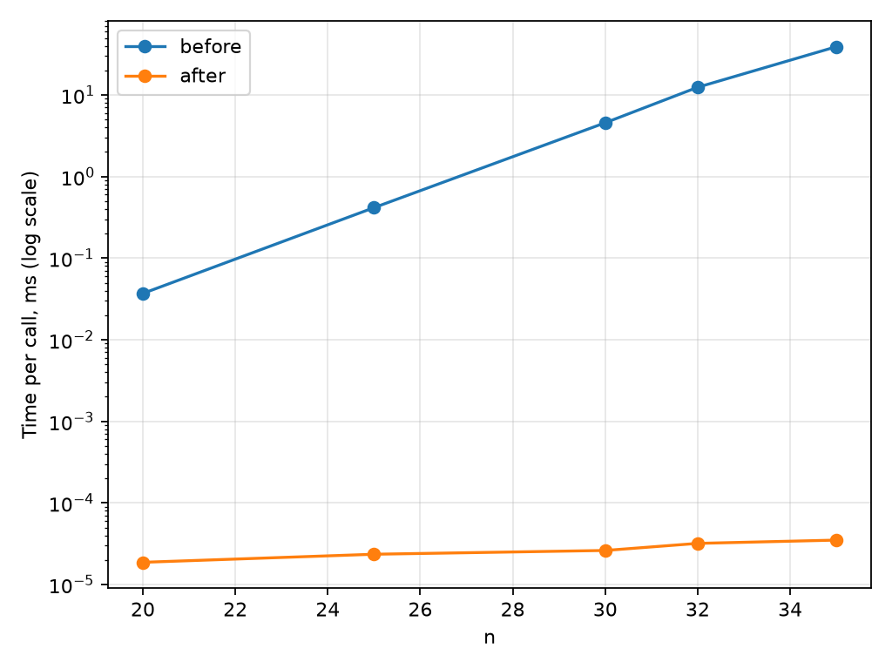

# Практическая работа 2 Оптимизация Фибоначчи
Вариант 6. C#, .NET 8, конфигурация Release.

## Исходный алгоритм
Для n<=1 возвращается n, иначе Fibonacci(n-1)+Fibonacci(n-2). Одни и те же подзадачи вычисляются многократно. Рекуррентность T(n)=T(n-1)+T(n-2)+O(1) даёт Theta(phi^n), где phi примерно 1,618; оценка O(2^n) также корректна, но грубее. Глубина стека O(n).

## Новый алгоритм
Хранятся два соседних числа. На каждом шаге пара сдвигается на одну позицию. После итерации с номером i current=F(i), previous=F(i-1). Следовательно, после завершения возвращается F(n).

```csharp
int previous = 0, current = 1;
for (int i = 2; i <= n; i++)
    (previous, current) = (current, unchecked(previous + current));
return current;
```

Время O(n), дополнительная память O(1). Для отрицательных n сохранён исходный возврат n. Тип int не заменён на long: начиная с F(47) сохраняется переполнение исходной программы в unchecked-контексте.

## Методика измерений
Прогрет JIT. Для каждого n выполнено пять серий, взята медиана. Медленный метод вызывается один раз в серии, быстрый - 100000 раз с делением общего времени на число вызовов. Результат используется, чтобы вычисления не превратились в неиспользуемый код. В таблице время одного вызова, включая накладные расходы делегата. Для столь короткого быстрого метода абсолютные наносекунды зависят от JIT и процессора; коэффициент следует читать как результат конкретного запуска.

n | До мс | После мс | Ускорение
--- | --- | --- | ---
20 | 0.036900 | 0.00001870 | 1973.4
25 | 0.415500 | 0.00002348 | 17692.1
30 | 4.557500 | 0.00002612 | 174456.4
32 | 12.418000 | 0.00003190 | 389279.0
35 | 39.016200 | 0.00003499 | 1115162.8



## Проверки
Выполнено сравнение исходного и нового методов для всех n от -3 до 30. Дополнительно проверены F(35)=9227465 и F(47)=-1323752223. Вывод: PASS: 36 checks (including int overflow). Измерения находятся в results/measurements.csv, график - results/comparison.png.

## Вывод
Рост времени рекурсивного решения близок к экспоненциальному: переход от n=30 к n=35 заметно дороже нескольких дополнительных итераций. Циклическое решение сохраняет контракт, убирает повторные вычисления и стек рекурсии. Формула Бине не применялась из-за погрешностей округления и лишней сложности.
