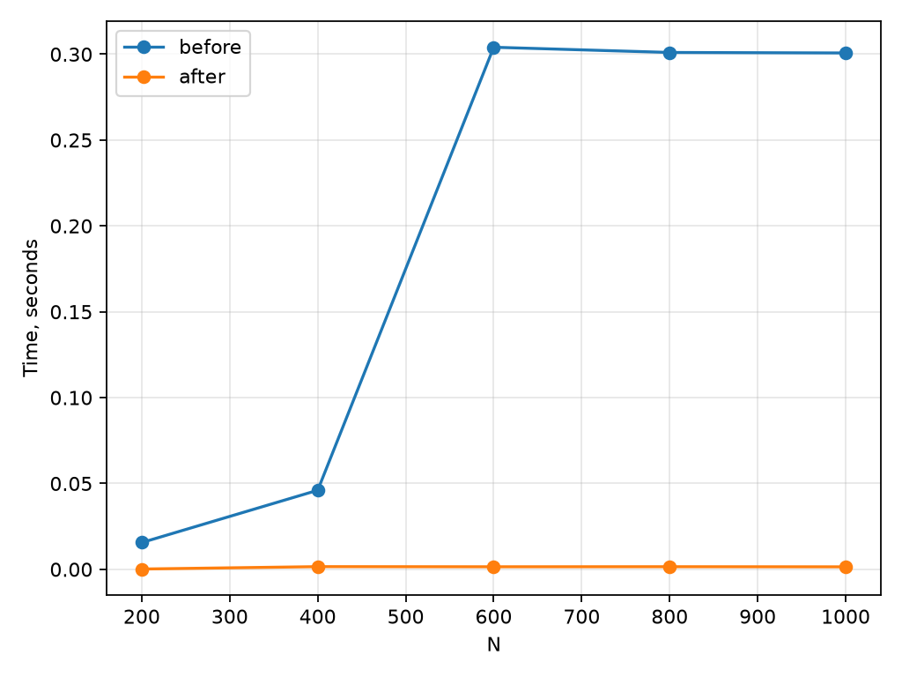

# Практическое занятие 3 Профилирование производительности
Вариант 6. Python 3.12. Цель - найти реальное узкое место и подтвердить ускорение при одинаковых входных данных.

## Задача и сложность
run_task вычисляет число Фибоначчи, строит вложенный словарь случайных чисел и суммирует числа внутри словарей и списков. Обозначим k=min(n//50+20,32), d=min(4,n//200+2), b=min(5,n//100+2). Исходное время O(phi^k+b^(d+1)); память O(k+b^(d+1)). Рекурсия fib многократно вычисляет одинаковые значения. build_dict и deep_sum линейны по числу узлов дерева.

При n>=600 параметры уже равны k=32, d=4, b=5. Поэтому зависимость от внешнего N выходит на плато: это не линейный алгоритм по N. Выбраны пять точек, показывающих и рост, и насыщение.

## Методика
Перед каждой серией random.seed(42), выполняется сборка мусора. Для каждого метода берётся медиана трёх отдельных запусков perf_counter. Время сборки мусора не входит в замер. Сравниваются возвращённые кортежи. Сторонние профилировщики запускаются отдельно от бенчмарка, чтобы не смешивать их накладные расходы с обычным временем.

N | До с | После с | Ускорение
--- | --- | --- | ---
200 | 0.015598 | 0.000184 | 84.63
400 | 0.046062 | 0.001578 | 29.19
600 | 0.304051 | 0.001500 | 202.77
800 | 0.301016 | 0.001536 | 195.97
1000 | 0.300720 | 0.001469 | 204.67

## Профилирование
cProfile+pstats при N=1000 показали 7049155 вызовов fib, включая рекурсивные. На fib приходится около 1,502 из 1,505 с профилируемого запуска. Остальные заметные операции: build_dict, deep_sum, isinstance и random.random. Их суммарный вклад намного меньше. Полный топ-10 сохранён в results/before_cprofile.txt и after_cprofile.txt. Значения времени cProfile нельзя напрямую сравнивать с обычным perf_counter.

Построчный анализ line_profiler сделан при N=200, чтобы не тратить время на миллионы инструментированных вызовов. Самая дорогая строка - return fib(n-1)+fib(n-2). Вывод по строкам сохранён в before_line_profile.txt и after_line_profile.txt.

## План и реализация
Узкое место | Техника | Эффект
--- | --- | ---
Повторные подзадачи fib | Итеративное вычисление двух соседних значений | O(phi^k) превращается в O(k)
Рекурсивный стек fib | Цикл вместо рекурсии | O(k) превращается в O(1)
Обход и построение словаря | Оставить без изменений | Сохранить порядок сложения и генератор случайных чисел

Не вводились NumPy, потоки и кэш: основную проблему решает короткий цикл. Новый run_task вызывает исходные build_dict и deep_sum, чтобы порядок операций с float и последовательность случайных чисел совпали. Полная оценка времени после изменения - O(k+b^(d+1)).

## Корректность
pytest: 9 passed. Проверены отрицательное значение, ноль, переходы размеров и N=1000. Перед сравнениями устанавливается одинаковый seed. Hypothesis сравнивает fib с исходником для случайных целых от -5 до 22. Отдельно проверена сумма смешанных вложенных структур. Набор проверяет исходный и оптимизированный результат на одних данных.

## Вывод
При N=1000 ускорение около 205 раз. После удаления экспоненциальной рекурсии основное время уходит на построение и обход небольшого дерева. Читаемость улучшилась, дополнительная память для fib уменьшилась. Дальнейшую оптимизацию дерева следует начинать с нового профилирования; текущий результат не требует усложнять код.
