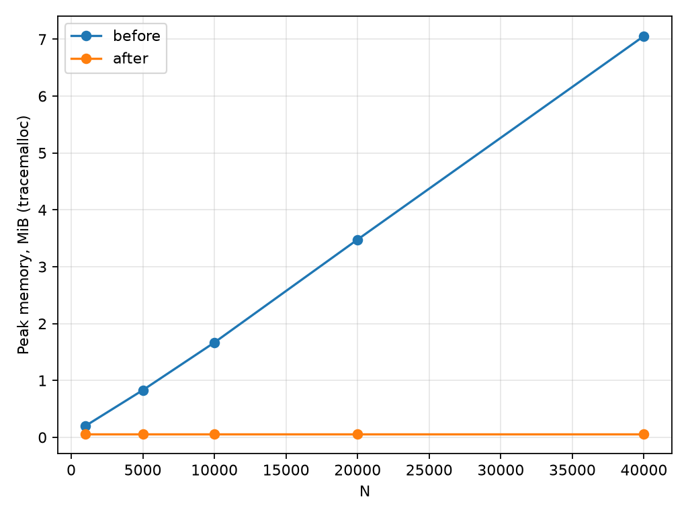

# Практическое занятие 4 Оптимизация памяти
Вариант 6. Python 3.12. Цель - убрать избыточное хранение и сохранить возвращаемый результат.

## Исходный подход
run_with_growing_cache создаёт cache_demo с числовыми ключами и строками hist_i. По числовому ключу хранится expensive_calc(key); по строковому - текущая сумма. Дополнительно expensive_calc использует lru_cache(maxsize=None), который продолжает жить после завершения функции. Возвращается только пара: число записей и сумма.

## Профилирование и план
Место | Проблема | Решение
--- | --- | ---
cache_demo[f"hist_{i}"] | N строк и N промежуточных float, которые не читаются | Не хранить историю
Числовая часть cache_demo | Дублирует внешний lru_cache | Удалить второй словарь
lru_cache(maxsize=None) | Удерживает всё больше ключей и float | Нормализовать ключ и ограничить 500 значениями
Ключи key | Результат зависит лишь от key%500 | Передавать остаток
len(cache_demo) | Размер входит в контракт | Вычислять размер по числу уникальных ключей

Для n>0 число записей равно n+min(n,n//2+10), для n<=0 равно 0. Числовые ключи и hist_i имеют разные типы и не пересекаются. Последовательность слагаемых и порядок float-сложения не меняются. Сумма expensive_calc считается тем же генератором, а не алгебраической формулой с другим округлением. Память исходника O(n), после изменения O(min(n,500)), то есть ограничена константой относительно n.

## Методика
tracemalloc измеряет пик и объём оставшихся Python-выделений сразу после вызова. Перед каждым измерением очищается lru_cache и выполняется gc.collect. Пять одинаковых размеров входа, отдельные измерения времени: медиана трёх запусков без tracemalloc. memory_profiler дополнительно измеряет RSS всего процесса с интервалом 0,01 с и выводит построчные данные при N=1000.

N | Пик до МиБ | Пик после МиБ | Экономия раз
--- | --- | --- | ---
1000 | 0.2022 | 0.0637 | 3.17
5000 | 0.8298 | 0.0637 | 13.02
10000 | 1.6678 | 0.0637 | 26.17
20000 | 3.4782 | 0.0637 | 54.58
40000 | 7.0568 | 0.0637 | 110.75

## Остаток памяти и время
N | Осталось до МиБ | Осталось после МиБ | Время до с | Время после с
--- | --- | --- | --- | ---
1000 | 0.0394 | 0.0633 | 0.01437 | 0.01043
5000 | 0.1990 | 0.0633 | 0.04899 | 0.01076
10000 | 0.4028 | 0.0633 | 0.09602 | 0.01148
20000 | 0.8105 | 0.0633 | 0.19106 | 0.01677
40000 | 1.6258 | 0.0633 | 0.37056 | 0.01590

Пик исходника включает локальные строки истории, значения и таблицу словаря. После возврата cache_demo уничтожен, но остаётся неограниченный декораторный кэш. Поэтому snapshot после вызова показывает оставшийся кэш, а не все объекты в момент пика. Файлы before_allocations.txt и after_allocations.txt нельзя трактовать как снимки пика.

memory_profiler для N=40000: до RSS 79,152-82,352 МиБ, после 81,473-81,473 МиБ. RSS включает интерпретатор, импортированные библиотеки, аллокатор и уже зарезервированные страницы, поэтому результат RSS нельзя подменять коэффициентом tracemalloc. Нулевой наблюдаемый прирост RSS не означает нулевые выделения. Построчный вывод сохранён в before_memory_lines.txt и after_memory_lines.txt.

## Корректность
pytest: 10 passed. Проверены n=-1,0,1,19,20,21,1000,10000, случайные n до 2000 через Hypothesis и ограничение размера кэша. Сравнивается точное равенство обеих частей кортежа, а не только близость сумм.

## Вывод
При N=40000 пик Python-выделений снизился примерно в 111 раз: с 7,06 до 0,064 МиБ. Время в этом запуске также снизилось с 0,371 до 0,016 с. Для маленьких N ограниченный LRU может удерживать больше памяти, чем исходный частично заполненный кэш; это видно в остатке при N=1000. Решение не хранит невостребованную историю и остаётся коротким.
