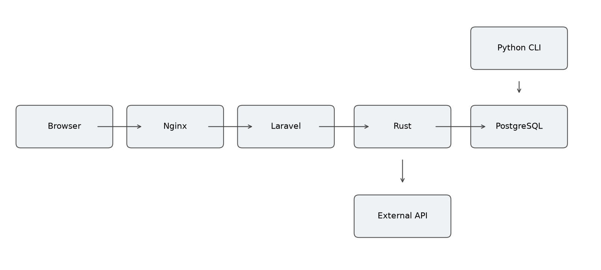
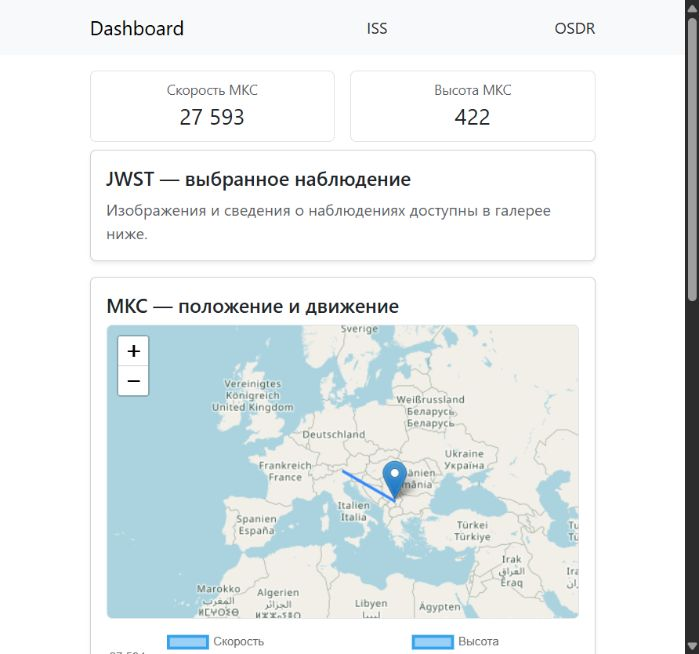
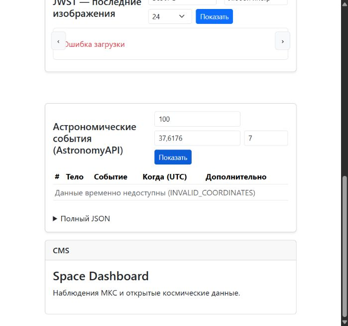

# Практическая работа 4 Рефакторинг космического дашборда
Общее задание без индивидуального варианта. Исходник: https://gitverse.ru/stasnorman/he-path-of-the-samurai . Сохранены Rust Axum SQLx, Laravel, PostgreSQL и Nginx. Pascal-генератор заменён небольшим Python CLI с тем же форматом данных.

## Анализ исходного состояния
Проект - распределённый монолит: компоненты развёртываются отдельно, но тесно связаны БД и неявными HTTP-контрактами. AppState и PgPool уже существовали, поэтому утверждать, что DI отсутствовала полностью, неверно. Слоёв routes/handlers/services/clients/repo/domain/config не было: Rust-код находился в одном main.rs. Обработчики возвращали Result<Json<T>, (StatusCode, String)>, а не ApiError. SQL присутствовал непосредственно в обработчиках.

TIMESTAMPTZ уже читался как DateTime<Utc>, это корректное соответствие: БД хранит момент времени, а клиент получает UTC-представление. NaiveDateTime используется только при разборе внешних строк без часового пояса; для них явно принято UTC. Нельзя обещать восстановление неизвестного часового пояса источника.

В Compose были жёстко заданные ключи и пароль, часть интервалов фоновых задач не передавалась. Создание Laravel происходило во время старта контейнера; успешный запуск зависел от Composer и сети. В CMS контроллер читал cms_blocks, хотя init.sql создавал cms_pages, и шаблон ссылался на отсутствующий layout. Было два одинаковых маршрута /page/{slug}.

## Архитектура после изменений
Клиент -> Nginx -> Laravel Controllers -> Services -> HTTP clients или PostgreSQL.
Laravel SpaceClient -> Rust handlers -> services -> clients и repo -> PostgreSQL.
Cron -> Python LegacyCSV -> CSV -> PostgreSQL COPY FROM STDIN.

Rust разбит на main.rs с маршрутизацией и AppState, handlers.rs, services.rs, clients.rs, repo.rs, domain.rs, config.rs, error.rs. Отдельный routes.rs не вводится ради нескольких строк Router. В handlers нет SQL: выборки и записи находятся в repo. AppState содержит пул и переиспользуемый reqwest Client. Репозитории реализованы функциями без дополнительной иерархии классов.

Laravel получил SpaceClient, UpstreamClient, AstroService и JwstFeedService. Контроллеры передают параметры сервисам, а сервисы формируют данные для страниц и JSON. Используются Service Layer, Adapter и Dependency Injection через контейнер Laravel. Для транспорта выбран UpstreamClient; замена конкретного поставщика выполняется в сервисе без переписывания HTTP-клиента. JWST-галерея и Astronomy events имеют разные схемы, поэтому взаимозаменяемость не означает подстановку их JSON без преобразования.



## Сводка изменений
Модуль | Проблема | Решение | Паттерн | Эффект
--- | --- | --- | --- | ---
Rust HTTP | Новый клиент на запрос | Один Client в AppState | DI | Переиспользование соединений. Такое изменение заметно облегчает проверку результата в ходе дальнейшего развития системы.
Rust jobs | Триггер и фон могут совпасть | Advisory transaction lock | Lock | Одна задача вида одновременно. Такое изменение заметно упрощает проверку результата в ходе дальнейшего развития системы.
Rust handlers | SQL смешан с HTTP | Функции repo | Repository | Отдельно читаются запросы. Такое изменение упрощает проверку модуля при дальнейших изменениях программного кода системы.
OSDR | Частичный индекс не совпадал с UPSERT | Условие WHERE dataset_id IS NOT NULL | Upsert | Обновление по бизнес-ключу. Это решение упрощает проверку поведения при дальнейших изменениях программного кода системы.
Space summary | Пять выборок по источникам | DISTINCT ON(source) | Batch query | Три обращения к БД вместо семи. Такое изменение также облегчает проверку результата в ходе дальнейшего развития системы.
Laravel | Неограниченное HTTP-ожидание | Таймауты и обработка ошибок | Adapter | Ограничено ожидание источника. Такое изменение заметно упрощает проверку результата в ходе дальнейшего развития системы.
Laravel | Повторные одинаковые чтения | File Cache TTL 10 или 30 с | Cache Aside | Меньше запросов к API и БД. Это решение упрощает проверку поведения при дальнейших изменениях программного кода системы.
CMS | Несовпадение схемы и шаблона | cms_pages и layouts.app | Refactoring | Корректная страница. Такое изменение упрощает проверку поведения при выполнении отдельных тестовых сценариев приложения.
Legacy | Shell-строка с параметрами | subprocess со списком и COPY STDIN | Adapter | Нет shell-подстановок. Такое изменение упрощает проверку поведения во время сопровождения и обновления учебного проекта.
Compose | Секреты и нестабильный старт | .env и сборка Laravel в образе | Configuration | Настройки отделены от кода. Это решение упрощает проверку поведения при дальнейших изменениях программного кода системы.

## Клиенты и фоновые задачи
reqwest Client задаёт connect timeout 3 с, общий timeout 10 с и User-Agent. Повторяются только сетевые сбои, 429 и 5xx: максимум три попытки с паузами 1 и 2 с. 403 не повторяется. Глобальный mutex сериализует запросы, успешные разделены паузой 250 мс; это простое ограничение для одного rust-контейнера. Раздельные лимиты провайдеров и Retry-After остаются направлением развития.

Планировщик берёт все интервалы из env; значение ограничено снизу одной секундой. Для каждого типа задания удерживается PostgreSQL advisory transaction lock до завершения операции. Автоматическое освобождение работает и при аварии соединения. Ручные триггеры используют те же функции. При занятом lock повторная работа пропускается; отдельная транзакция блокировки не подменяет транзакции записи. Пул увеличен до 20 соединений с учётом удерживаемых блокировок. Масштабирование числа реплик требует повторного расчёта пула.

## База и производительность
OSDR использует dataset_id как бизнес-ключ: повторная синхронизация обновляет запись, а не создаёт дубликат. Для частичного уникального индекса UPSERT содержит такое же условие WHERE dataset_id IS NOT NULL. Записи без business key продолжают вставляться отдельно: нельзя объявить их тождественными без правила предметной области.

История ISS и space_cache сохраняется: замена всех INSERT на UPSERT уничтожила бы исторические наблюдения. Для latest-поиска индекс (source,id DESC) соответствует фильтру и сортировке. Summary собирает последние значения одним DISTINCT ON, затем отдельно ISS и число OSDR: 3 SQL-запроса вместо 7. Это сокращение числа запросов по коду; фактическое ускорение зависит от данных и проверяется отдельным замером, численный процент не выдумывается.

ViewModel удобен для страницы: заранее вычисленные метрики, подписи и ссылки. DTO удобен для передачи данных между слоями. В небольшом проекте массивы Laravel выполняют роль простых ViewModel; новые классы для каждого массива не вводились. SQL/HTTP не должны появляться в Blade.

## Ошибки и безопасность
Ожидаемая ошибка Rust и основных прокси возвращается с HTTP 200 и телом {"ok":false,"error":{"code":"UPSTREAM_403","message":"...","trace_id":"..."}}. Успешные структуры не оборачиваются новым полем, чтобы сохранить читающий их фронтенд. Низкоуровневые отклонения HTTP-парсера и 404 страницы - отдельные случаи, это не бизнес-ошибки источника.

Логи Rust содержат код и trace_id, без URL с ключом и без строк подключения. В Laravel не возвращается raw upstream body при сбое. Ошибки не кэшируются. Локальный .env исключён из Git; setup.ps1 создаёт новый пароль. Значения секретов предоставляются через env. Старые опубликованные ключи не перенесены в рабочую конфигурацию.

CMS получает данные через CmsRepository и Query Builder. HTMLPurifier оставляет разрешённые заголовки, абзацы, списки и ссылки, удаляя script, обработчики событий и javascript-URL. Очищенный HTML передаётся в Blade: обычное форматирование сохраняется. Дублирующиеся CMS-блоки и SQL из dashboard.blade.php удалены. Координаты Astronomy проверяются по диапазону. Унаследованные GET-триггеры Rust сохранены для совместимости; в публичной системе их следует закрыть авторизацией и отдельным согласованным контрактом.

## Legacy и CSV-контракт
Исходный язык - Object Pascal Free Pascal. Сохранены GetEnvDef, RandFloat и GenerateAndCopy. RandFloat выбирает значение minV+random*(maxV-minV). Название файла telemetry_YYYYMMDD_HHMMSS.csv; колонки recorded_at,voltage,temp,source_file; одна запись на запуск. Напряжение 3,2..12,6, температура -50..80, два знака после точки. В контейнере используется UTC; конкретная последовательность PRNG Pascal и Python не совпадает, сохраняются алгоритм диапазона и формат, а не случайные биты.

Cron по умолчанию */5 * * * *, задаётся LEGACY_CRON. CLI пишет результат в stdout, ошибки - в stderr, контейнер запускает crond на переднем плане. PostgreSQL получает CSV через COPY FROM STDIN, без динамического shell. План перехода: сравнить заголовки и диапазоны, запустить Python на тестовой БД, затем переключить Compose; Pascal-код оставлен как справочный исходник и не запускается.

## Проверки и воспроизведение
setup.ps1 -> docker compose up --build -d. Веб: http://localhost:8080/dashboard, Rust: http://localhost:8081/health. PHPUnit: docker compose exec --user www-data php php artisan test --filter=SpaceClientTest. Rust: docker compose run --rm --build rust_tests. Приёмочные сценарии описаны в ACCEPTANCE.md, локальные unit-тесты legacy - в tests/test_legacy.py. Статус фактических проверок вынесен в ПРОВЕРКА.md. Контейнеры собраны и запущены на этом компьютере после настройки WSL.

## Вывод
Основные изменения направлены на измеримые причины проблем: количество SQL-обращений, время ожидания внешних API, повторные чтения и наложение фоновых задач. Миграция всего проекта на другой стек не требуется. Локальная приёмка выполнена; для успешных ответов закрытых внешних провайдеров нужны собственные действующие ключи. Исходная ссылка в начале отчёта указывает задание. Итоговое решение: https://github.com/lavasheva/opt_code/tree/main/06_Космический_дашборд .

## Повторяемая сборка и исправления запуска
Compose-проекту задано ASCII-имя space-dashboard: автоматическое имя из кириллической папки давало invalid reference format. Shell-скрипты имеют LF, а Dockerfile дополнительно удаляет CR; это устранило остановку PHP на Windows-переносах строк. Nginx запускается после healthcheck PHP-FPM.

Composer отказался устанавливать Laravel 11 из-за известных уязвимостей. Использована Laravel 12 с сохранением Blade, маршрутов и контроллеров. SQLx 0.7 не скомпилировалась с текущим Rust; обновлена до 0.8.6. Проверенные версии зависимостей зафиксированы в Cargo.lock и composer.lock. Повторная сборка Rust использует --locked, PHP - composer install.

## Фактические результаты проверки
Проверка | Результат
--- | ---
Rust unit и PostgreSQL integration | 7 passed, 0 failed
Laravel Feature Tests | 5 passed, 14 assertions
UPSERT OSDR | После двух записей один dataset_id, актуальный title
TIMESTAMPTZ | Прочитан DateTime UTC с ожидаемым моментом времени
Advisory lock | Второе соединение не получает занятый lock, после освобождения получает
Legacy CSV | Реальный COPY 1, запись появилась в PostgreSQL
Страницы dashboard, osdr, welcome, unsafe | HTTP 200
Astronomy при lat=100 | HTTP 200, ok=false, INVALID_COORDINATES
Astronomy без ключей | HTTP 200, ok=false, MISSING_CREDENTIALS
JWST без действующего ключа | HTTP 200, ok=false, UPSTREAM_401
Карта и графики | Получены настоящие координаты, скорость и высота МКС

Для OSDR внешний источник ответил 502, поэтому реальная таблица при проверке была пустой. Это не заменялось вымышленными данными. Поведение записи и обновления OSDR проверено отдельно интеграционным тестом на настоящей PostgreSQL. JWST/Astronomy требуют действующих ключей. Полные результаты: rust-tests.log, php-tests.log, http-results.json и runtime-logs.txt.

Наблюдение в браузере подтвердило: фильтр «По программе» показывает поле номера программы; координата 100 выводит код ошибки на странице; в unsafe-странице отсутствует внедрённый script. Графики адаптированы к существующему контракту /iss/trend и собирают фактические точки из /last без выдуманной истории.

## Выдержки из кода
Получение данных витрины одним запросом:

```rust
sqlx::query("SELECT DISTINCT ON (source) source, fetched_at, payload FROM space_cache ORDER BY source, id DESC")
    .fetch_all(pool).await
```

Получение CMS-страницы вне Blade:

```php
return Cache::remember('cms:'.$slug, 60, fn() =>
    DB::table('cms_pages')->where('slug', $slug)->first());
```

## Фрагменты реальных журналов

```
rust_iss listening on 0.0.0.0:3000
osdr err UPSTREAM_502
apod err UPSTREAM_403
COPY 1
Imported telemetry_20261117_205500.csv
```

Первый ряд означает запуск сервера, строки UPSTREAM фиксируют реальные ошибки провайдеров, COPY подтверждает импорт CSV. Ключи и пароли в эти фрагменты не включены.

## Скриншоты работающего интерфейса
Главная страница с реальными данными МКС и картой:



Проверка некорректной координаты в интерфейсе и очищенный CMS-блок:


